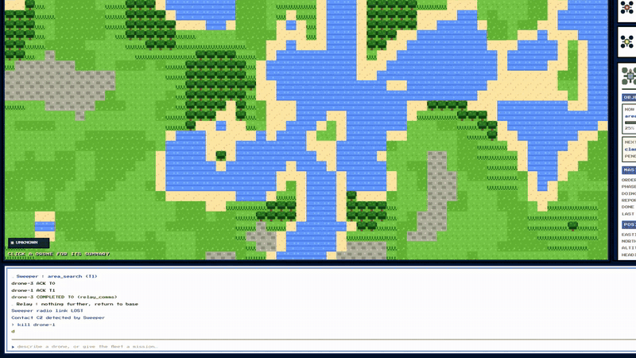

# DroneFleet

Describe your drones in plain English, give them a mission, and DroneFleet tells you **whether the
fleet can actually do it** before anything takes off. If it can't, it names exactly what's missing.
Then it flies the mission in a physics sim over MQTT, rendered as a GBA-style overworld.

<p align="center">
  <a href="docs/demo.mp4"></a>
  <br><a href="docs/demo.mp4"><b>▶ Watch the 44-second demo (with sound)</b></a>
</p>

```
> demo
> find survivors in the north flood zone and deliver supplies
FEASIBLE
4 tasks across 3 drones. Type `launch` to fly it, or `why` for the breakdown.
> launch
> kill drone-1
Sweeper (drone-1) is not responding — lost
Re-validated after loss of Sweeper: FEASIBLE → INSUFFICIENT
MISSING_CAPABILITY: task T1 needs 'area_search' and no registered drone provides it
MISSING_CAPABILITY: task T2 needs 'classify_survivor' and no registered drone provides it
```

## Run it

```bash
python3 run.py          # then open http://127.0.0.1:8080
```

Python 3.10+ and nothing else: no `pip install`, no broker to set up. The MQTT 3.1.1 broker, the MQTT
client, the WebSocket server and a YAML parser are all written in this repo in plain `asyncio`.
A local LLM (Ollama) is used if it's installed and skipped if it isn't; `./start.sh` sets it up.

Type `prompts` in the dialogue box for everything you can say.

## What makes it work

**The verdict is a proof.** The planner chains backwards from the mission goal to the tasks it needs,
binds each task to a drone by capability, then checks endurance, radio range, dependencies and
safety interlocks with plain deterministic code. It returns one of three answers:

| Verdict | Meaning |
|---|---|
| `FEASIBLE` | Every task has a drone, every dependency resolves, every limit holds |
| `DEGRADED` | It will run, with a named risk (usually a radio link that drops mid-sweep) |
| `INSUFFICIENT` | A provable gap, with the fix spelled out |

The LLM may *propose* a parse of your sentence; the planner re-checks everything regardless.
A model never decides feasibility.

**It re-validates live.** Kill a drone mid-mission and the master notices the missed heartbeats,
re-runs the same validator on what's left, and the verdict flips `FEASIBLE → INSUFFICIENT` on screen.

**Each drone is its own agent.** Every drone holds its own MQTT connection, acknowledges or rejects
tasks on its own terms (low battery means no), and streams progress back. Drones launched as separate
OS processes join over a versioned protocol ([DRONE_PROTOCOL.md](DRONE_PROTOCOL.md)) and get planned in:

```bash
python3 run.py --no-llm --mqtt-port 18830
python3 -m fleet.drone_node --id scout-1 --profile recon --mqtt-port 18830
```

**The physics can flip a verdict.** Turn-rate-limited flight, drifting wind, battery drain from hover
power plus drag, 2.4 GHz path loss with relay chaining, and sensor footprints that set the search
spacing. The fog on the map clears only where a sensor actually swept.

**Missions are data.** Search and rescue, perimeter security and infrastructure inspection are YAML
packs in [`packs/`](packs/). Writing a new domain needs no code.

## Layout

```
fleet/core/    the engine: planner, ontology, NLP — imports no network, web or sim code
fleet/net/     MQTT broker and client, with drop-rate and latency injection
fleet/agents/  the master and one agent per drone
fleet/sim/     physics
fleet/web/     HTTP + WebSocket bridge; the browser only observes
frontend/      the overworld
packs/         mission domains
```

## Tests

No pytest, no network needed except where noted:

```bash
python3 -m tests.test_planner       # 58 checks, engine only
python3 -m tests.test_integration   # 29 checks, real broker and physics
python3 -m tests.test_protocol      # 88 checks, external drones over the bus
python3 -m tests.test_llm           # 28 checks, real Ollama (skips if absent)
```

## Docs

- [User manual](docs/MANUAL.md): every command, writing prompts and domain packs, fault injection,
  configuration, internals and troubleshooting
- [DRONE_PROTOCOL.md](DRONE_PROTOCOL.md): the wire protocol for external vehicles
